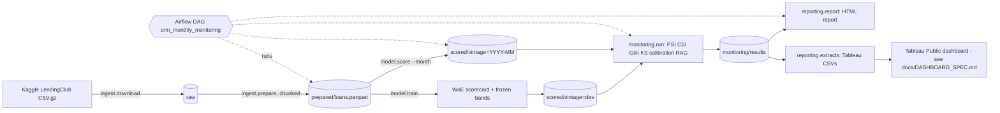

# Credit-risk model monitoring

An automated, bank-style monitoring system for a **probability-of-default (PD) model**. A PD scorecard is trained
on LendingClub loans (2012-13), frozen, and then monitored **month by month over 36 later origination vintages
(2014-2016)** the way a bank's model-risk team monitors a live model: population stability (PSI/CSI),
discrimination (AUC, Gini, KS), calibration tests, red/amber/green (RAG) alerts, an auto-generated report each
run, and flat data extracts for a Tableau dashboard. Airflow orchestrates the monthly cycle and supports backfill.

## Why this matters
Banks must show regulators that models used for lending and risk decisions *keep working* after deployment.
Monitoring answers: has the customer population shifted, can the model still rank good from bad, and are predicted
default rates still right? This project automates that workflow end to end, with explainable (not black-box) statistics.

## Architecture

Components: `ingest/` data acquisition, `model/` PD model, `monitoring/` metrics + alert engine, `reporting/`
reports and extracts, `orchestration/` Airflow DAG, `common/` shared paths/config/schemas.
Interfaces between components are Parquet files with exact schemas: [docs/CONTRACTS.md](docs/CONTRACTS.md).

## Data
LendingClub accepted loans 2007-2018Q4 from Kaggle (`wordsforthewise/lending-club`, **CC0-1.0**), read in chunks
(2.26M rows scanned, only needed columns kept). Scope: 36-month loans issued 2012-01..2016-12 (913,130 loans).
Default = Charged Off/Default, non-default = Fully Paid; still-current loans are excluded from outcome metrics.
The data and token are never committed; `tests/fixtures/loans_sample.parquet` is a 4,200-loan real sample.

## Run it
```bash
make setup                 # Python 3.12 venv, pinned deps (uv)
make test lint             # fixtures only
make demo                  # whole pipeline on the sample fixture, a few minutes
make e2e                   # full real run: needs ~/.kaggle/access_token; ~5 minutes, ~1.2 GB RAM peak
make setup-airflow         # optional, then:
bash orchestration/run_dag_test.sh 2014-01 2014-02   # run the DAG natively, one run per month
```
Outputs land in `data/` (git-ignored): `data/reports/monitoring_report_<month>.html` (36 reports) and
`data/tableau/*.csv`. Build the dashboard with [docs/DASHBOARD_SPEC.md](docs/DASHBOARD_SPEC.md).

## Results (real run; full detail in [docs/RESULTS.md](docs/RESULTS.md))
* PD scorecard (7 features, WoE logistic): out-of-time **AUC 0.666, Gini 0.331, KS 0.247** (GBM challenger Gini 0.339).
* 36 monthly vintages monitored; **1,512 metric rows**, 12 metric families; overall RAG: 30 RED, 6 AMBER.
* The monitoring found real model decay: the **calibration ratio (observed/predicted default rate) rose from 1.02
  to 1.54** as the model under-predicted defaults for later vintages; **score PSI peaked at 0.28 (red) in 2016-01**, and
  interest-rate characteristic drift (CSI) was red in 24 months, while **Gini stayed 0.31-0.38** (ranking held up; levels drifted).
* Airflow DAG verified with `airflow dags test` on real data: all 6 tasks succeed per month; idempotent per month.

## Honest notes
* Public **consumer** loan data, not bank corporate/wholesale data; a company credit-rating model was not built.
* Docker was not used (not available); Airflow runs natively via `airflow dags test`, no scheduler/webserver was deployed.
* The PD model is intentionally simple; absolute performance (Gini ~0.33) reflects pre-screened LendingClub applicants.
* Calibration tests at ~10k loans/month are very powerful, so p-value alerts fire often; thresholds are configurable
  in `config/thresholds.yaml` and the trade-off is discussed in [docs/WALKTHROUGH.md](docs/WALKTHROUGH.md).
* 2016 vintages have no observable outcomes yet (36-month loans), so they are monitored on stability only.

## Layout
`docs/` CONTRACTS, RESULTS, WALKTHROUGH, DASHBOARD_SPEC, plus per-component notes (`docs/model`, `docs/monitoring`, `docs/reporting`).
