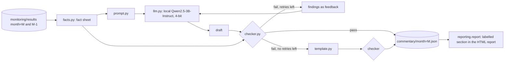

# AI-drafted, verified monitoring commentary

Each monthly monitoring report opens with a short analyst-style commentary (what changed, which alerts
fired, likely drivers, recommended action). A small open-weight LLM, run locally, drafts it from that
month's computed results. A rule-based **checker** then verifies every number, metric, month, direction
word and RAG status in the draft against the same results and **blocks** the draft if anything is
unsupported. A blocked draft goes back to the model with the checker's findings (up to 2 retries); if no
draft passes, the report shows a deterministic template summary instead. The report always says which
path was taken. This was built and evaluated on the real 36-month run; it is a portfolio project and has
not been used in production.



## Run it
```bash
make setup-ai                        # CUDA torch + transformers + bitsandbytes (optional extra "ai")
python -m commentary.run --all --model-id Qwen/Qwen2.5-3B-Instruct   # or a local snapshot directory
make report                          # reports now carry the commentary section
python -m commentary.evaluate        # writes data/commentary/eval_summary.json and the block below
python -m commentary.run --month 2015-06 --drafter template          # no LLM: template only
```
Outputs: `data/commentary/month=<M>.json` holds the published text, the path taken, **every draft with
its checker findings**, the model id, revision and decoding settings, and timings.

## Components (`commentary/`)
| module | role |
|---|---|
| `facts.py` | Reads `month=M` and `month=M-1` results Parquet into a typed fact sheet (value, previous value, RAG, thresholds, dev baseline for Gini/KS). Single source of truth for both the prompt and the checker. |
| `prompt.py` | Renders the fact sheet (values at fixed precision, "rose/fell (improved/deteriorated)" pre-computed, alert list) plus 7 writing rules; builds the retry message from checker findings. |
| `llm.py` | `Drafter` interface (`generate(messages) -> str`, `settings()`). `HFDrafter` runs any Hugging Face chat model locally; `ScriptedDrafter` replays fixed drafts for tests. Swapping the model is one argument. |
| `checker.py` | Deterministic claim extraction and verification (below). |
| `template.py` | Deterministic fallback commentary from the facts; it is checked too. |
| `run.py` | Draft -> check -> retry with feedback -> fallback loop; writes the JSON. |
| `evaluate.py` | The evaluation in this document. |

## Model and settings
* `Qwen/Qwen2.5-3B-Instruct`, Hugging Face revision `aa8e72537993ba99e69dfaafa59ed015b17504d1`
  (Apache-2.0), loaded with transformers + bitsandbytes **4-bit NF4** (double quantisation, fp16 compute)
  on a laptop **GTX 1650 (4 GB)**. No API, no key, nothing leaves the machine.
* Greedy decoding (`do_sample=False`), `max_new_tokens=320`, `repetition_penalty=1.05`, seed 0. The
  exact settings and library versions are stored in every commentary JSON.
* Why this size: the 1650 has about 3 GB free; 3B in 4-bit fits (~2.2 GB) and follows the format rules
  far better than 0.5B/1.5B models, while 7B does not fit.

## What the checker verifies
The draft is split into sentences and clauses. The checker finds every **mention** (metric names and
synonyms such as "population stability", "observed-to-predicted"; the 12 CSI features by plain-English
name; score bands) and every **claim item** (number, RAG word, direction word, threshold comparison,
month, "not available" phrase), attaches each item to the mention it is about (same clause first, then the
sentence; "Gini and KS fell" attaches to both) and checks it:

| claim | rule / tolerance |
|---|---|
| number | must equal a true value **correctly rounded to the precision written**: abs(claimed - true) <= 0.5 x 10^-decimals ("about" widens to 2%). Allowed targets: this month's value; last month's value only with "from/previous/was"; thresholds only in a threshold context; the dev baseline only with "baseline/development"; for the calibration ratio also (ratio - 1). Percentages are compared on the percent scale. |
| comparison | "above 0.25", "< 0.001": the inequality must hold for the true value. |
| RAG status | must equal the stored RAG (last month's when phrased "from AMBER", "last month"); "AMBER or RED" is a set; "breach" means AMBER/RED; "within tolerance" means GREEN; a status for a metric that has none (AUC, volume) fails. |
| threshold phrase | "above / crossed / below the red (amber) threshold" must be consistent with the stored RAG and the metric's risk direction. |
| direction | "rose/fell" must match the sign of the change vs last month; "stable/unchanged" needs abs(change) <= max(0.005, 2% of last month); "improved/deteriorated" uses the risk direction (for the calibration ratio, distance from 1.0); no previous month means no direction claim is allowed. |
| month | every month/year named must be this month or the previous one (dev years only with "development"). |
| metric | metrics and features that are not monitored (Brier, LGD, approval rate, loan term, ... and unknown acronyms) fail as **invented**; a value for a metric that is n/a this month (outcome metrics on immature vintages) fails as **unavailable**. |
| counts | "3 features are RED", "9 headline alerts" must match the results. |
| drivers | in "Likely drivers" (or sentences with "driven by / due to / reflects"), a named feature must have AMBER/RED CSI or be among the top-3 CSI. |
| contradiction | "no alerts / all metrics green" when alerts fired; "not available" for a metric that is available. |
| omission | all four paragraphs must be present, and the overall status, every RED model-level metric and the most drifted RED feature must be mentioned. |

Anything a number cannot be attached to is checked against every value in the month's results and
flagged as **unsupported** if it matches none. Free-text judgement ("recommended action") is not
verified beyond the numbers, metrics and statuses it contains.

## Evaluation (real run, 36 months)
How it was measured:
* **Drafting loop:** `commentary.run --all` on the real results; every attempt and its findings are logged.
* **Checker recall:** `evaluate.py` takes every text the checker accepted (the published LLM drafts and
  the template for each month) and inserts **one deliberate error** of a known type (wrong number off by
  15-50%, swapped RAG word, flipped direction, shifted month, invented metric sentence, false "no alerts",
  driver swapped to a GREEN feature, value given for an unavailable metric, a RED alert deleted), with a
  fixed seed. Recall = share of corrupted drafts the checker rejects.
* **False alarms:** a second, independently worded correct commentary per month (different sentence
  structure and 2-decimal rounding) must pass.
* **Independent residual check:** a separate audit that shares no code with the checker re-reads the raw
  results Parquet and flags any number in the *published* text that equals no value, threshold or simple
  transform of any row in this or last month's table, any other month, and false all-clear claims.
  The author (the AI coding agent that built this, not a human) also read every published LLM
  commentary against its fact sheet; findings are listed under Weaknesses.

PLACEHOLDER-RESULTS

<!-- eval:start -->
<!-- eval:end -->

## Efficiency, honestly
PLACEHOLDER-EFFICIENCY

## Weaknesses
PLACEHOLDER-WEAKNESSES
