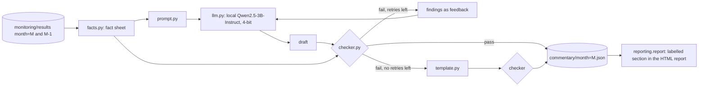

# AI-drafted, verified monitoring commentary

Each monthly monitoring report opens with a short analyst-style commentary (what changed, which alerts
fired, likely drivers, recommended action). A small open-weight LLM, run locally, drafts it from that
month's computed results. A rule-based **checker** then verifies every number, metric, month, direction
word and RAG status in the draft against the same results and **blocks** the draft if anything is
unsupported. A blocked draft goes back to the model with the checker's findings (up to 2 retries); if no
draft passes, the report shows a deterministic template summary instead. The report always says which
path was taken. This was built and evaluated on the real 36-month run; it is a portfolio project and has
not been used in production.



## Run it
```bash
make setup-ai                        # CUDA torch + transformers + bitsandbytes (optional extra "ai")
python -m commentary.run --all --model-id Qwen/Qwen2.5-3B-Instruct   # or a local snapshot directory
make report                          # reports now carry the commentary section
python -m commentary.evaluate        # writes data/commentary/eval_summary.json and the block below
python -m commentary.run --month 2015-06 --drafter template          # no LLM: template only
```
Data for the real run: only the accepted-loans file was fetched (`kaggle datasets download -f
accepted_2007_to_2018Q4.csv.gz`, about 375 MB, because the full dataset zip is about 1.3 GB on a slow link); the repo's
`ingest.download` then skips the download as the file exists, and `ingest.prepare` onwards ran unchanged. The
real run reproduced the README monitoring numbers exactly.

Outputs: `data/commentary/month=<M>.json` holds the published text, the path taken, **every draft with
its checker findings**, the model id, revision and decoding settings, and timings.

## Components (`commentary/`)
| module | role |
|---|---|
| `facts.py` | Reads `month=M` and `month=M-1` results Parquet into a typed fact sheet (value, previous value, RAG, thresholds, dev baseline for Gini/KS). Single source of truth for both the prompt and the checker. |
| `prompt.py` | Renders the fact sheet (values at fixed precision, "rose/fell (improved/deteriorated)" pre-computed, alert list) plus 7 writing rules; builds the retry message from checker findings. |
| `llm.py` | `Drafter` interface (`generate(messages) -> str`, `settings()`). `HFDrafter` runs any Hugging Face chat model locally; `ScriptedDrafter` replays fixed drafts for tests. Swapping the model is one argument. |
| `checker.py` | Deterministic claim extraction and verification (below). |
| `template.py` | Deterministic fallback commentary from the facts; it is checked too. |
| `run.py` | Draft -> check -> retry with feedback -> fallback loop; writes the JSON. |
| `evaluate.py` | The evaluation in this document. |

## Model and settings
* `Qwen/Qwen2.5-3B-Instruct`, Hugging Face revision `aa8e72537993ba99e69dfaafa59ed015b17504d1`
  (Apache-2.0), loaded with transformers + bitsandbytes **4-bit NF4** (double quantisation, fp16 compute)
  on a laptop **GTX 1650 (4 GB)**. No API, no key, nothing leaves the machine.
* First draft: greedy decoding. Retries: seeded sampling (temperature 0.7, top-p 0.9, seed 0 + attempt),
  because greedy retries reproduced the rejected draft word for word. `max_new_tokens=400`,
  `repetition_penalty=1.05`. A retry prompt is the fact sheet plus the checker's findings on the last draft
  (each finding quotes the offending sentence); the rejected draft itself is not replayed, since the model
  copied it. Settings and library versions (transformers 5.21.0, torch 2.14.1+cu126) are stored in every
  commentary JSON.
* Why this size: the 1650 had about 3.4 GB free; 3B in 4-bit peaked at 2.4 GB of VRAM (3.1 GB host RAM)
  and a 7B model does not fit. Smaller models (0.5B/1.5B) were not evaluated.

## What the checker verifies
The draft is split into sentences and clauses. The checker finds every **mention** (metric names and
synonyms such as "population stability", "observed-to-predicted"; the 12 CSI features by plain-English
name; score bands) and every **claim item** (number, RAG word, direction word, threshold comparison,
month, "not available" phrase), attaches each item to the mention it is about (same clause first, then the
sentence; "Gini and KS fell" attaches to both) and checks it:

| claim | rule / tolerance |
|---|---|
| number | must equal a true value **correctly rounded to the precision written**: abs(claimed - true) <= 0.5 x 10^-decimals ("about" widens to 2%). Allowed targets: this month's value; last month's value only with "from/previous/was"; thresholds only in a threshold context; the dev baseline only with "baseline/development"; for the calibration ratio also (ratio - 1). Percentages are compared on the percent scale. |
| comparison | "above 0.25", "< 0.001": the inequality must hold for the true value. |
| RAG status | must equal the stored RAG (last month's when phrased "from AMBER", "last month"); "AMBER or RED" is a set; "breach" means AMBER/RED; "within tolerance" means GREEN; a status for a metric that has none (AUC, volume) fails. |
| threshold phrase | "above / crossed / below the red (amber) threshold" must be consistent with the stored RAG and the metric's risk direction. |
| direction | "rose/fell" must match the sign of the change vs last month; "stable/unchanged" needs abs(change) <= max(0.005, 2% of last month); "improved/deteriorated" uses the risk direction (for the calibration ratio, distance from 1.0); no previous month means no direction claim is allowed. |
| month | every month/year named must be this month or the previous one (dev years only with "development"). |
| metric | metrics and features that are not monitored (Brier, LGD, approval rate, loan term, ... and unknown acronyms) fail as **invented**; a value for a metric that is n/a this month (outcome metrics on immature vintages) fails as **unavailable**. |
| counts | "3 features are RED", "9 headline alerts" must match the results. |
| drivers | in "Likely drivers" (or sentences with "driven by / due to / reflects"), a named feature must have AMBER/RED CSI or be among the top-3 CSI. |
| contradiction | "no alerts / all metrics green" when alerts fired; "not available" for a metric that is available. |
| omission | all four paragraphs must be present, and the overall status, every RED model-level metric and the most drifted RED feature must be mentioned. |

Anything a number cannot be attached to is checked against every value in the month's results and
flagged as **unsupported** if it matches none. Free-text judgement ("recommended action") is not
verified beyond the numbers, metrics and statuses it contains.

## Evaluation (real run, 36 months)
How it was measured:
* **Drafting loop:** `commentary.run --all` on the real results; every attempt and its findings are logged.
* **Checker recall:** `evaluate.py` takes every text the checker accepted (the published LLM drafts and
  the template for each month) and inserts **one deliberate error** of a known type (wrong number off by
  15-50%, swapped RAG word, flipped direction, shifted month, invented metric sentence, false "no alerts",
  driver swapped to a GREEN feature, value given for an unavailable metric, a RED alert deleted), with a
  fixed seed. Recall = share of corrupted drafts the checker rejects.
* **False alarms:** a second, independently worded correct commentary per month (different sentence
  structure and 2-decimal rounding) must pass.
* **Independent residual check:** a separate audit that shares no code with the checker re-reads the raw
  results Parquet and flags any number in the *published* text that equals no value, threshold or simple
  transform of any row in this or last month's table, any other month, and false all-clear claims.
  The author (the AI coding agent that built this, not a human) also read every published LLM
  commentary against its fact sheet; findings are listed under Weaknesses.

### Headline
* **The checker did its job; the 3B model mostly did not.** Only **3 of 36 first drafts passed** and
  **1 more passed after feedback**; **32 months (89%) were published as the deterministic template**. No
  unverified LLM text reached a report.
* The rejections were overwhelmingly **real errors**. The author audited every issue in the 33 rejected
  first drafts (86 distinct issue/sentence pairs): **59 were genuine model errors, 26 were checker false
  alarms, 1 was ambiguous**. 27 of the 33 rejected first drafts contained at least one genuine error; 5
  were rejected only by false alarms (2014-12, 2015-12, 2016-05, 2016-07, 2016-09), 1 only by the ambiguous case.
* Typical genuine errors: inventing status transitions ("fell from AMBER to GREEN" when it was GREEN
  both months), calling an AMBER feature RED, saying the calibration ratio "worsened" when it improved,
  swapping "from X to Y", writing a 12.9% default rate as "0.129%", giving AUC a RAG status, dropping
  the "Recommended action" paragraph.
* The false alarms had three causes, all fixed afterwards with regression tests: (i) a bug where the
  fact-sheet label "Calibration ratio (observed / predicted default rate)" was read as *mean PD* (14 of
  the 26), (ii) direction words about "the model's performance" or after "indicating" being read as a
  metric's monthly move (9), (iii) attachment/wording slips ("a rising calibration ratio", "after being
  AMBER", "RED status overall"). Re-checking the same 101 logged drafts with the fixed checker: 8/36 first
  drafts pass (exactly the 3 + the 5 false-alarm months) and 11 months have a passing draft. The published
  reports are left as the run produced them.
* **Residual errors** (independent check). The raw-Parquet audit found no unsupported number, month or
  all-clear claim in any published text. Reading the 11 drafts that pass the fixed checker against their
  fact sheets found **qualitative errors the checker cannot see in 6 of them**, including 2 of the 4
  that were actually published: 2014-07 "status shifted to RED ... while it was RED in June", and 2015-08
  "issues with the model's calibration and discrimination" while Gini and KS were GREEN. Others: "AMBER
  and RED respectively" in the wrong order, "headline alerts remain unchanged" when they changed, "these
  alerts are new". The checker verifies atomic claims (value, status, direction, month, metric); it does not
  verify relations between facts or interpretations.

<!-- eval:start -->
<!-- generated by `python -m commentary.evaluate`; do not edit by hand -->
Months evaluated: **36**. Drafting model: `Qwen/Qwen2.5-3B-Instruct` (nf4, greedy decoding).

| drafting loop | value |
|---|---|
| first drafts that passed the checker | 3/36 (8%) |
| published: LLM, first draft | 3/36 (8%) |
| published: LLM, after checker feedback (max 2 retries) | 1/36 (3%) |
| published: deterministic template fallback | 32/36 (89%) |
| LLM drafts generated in total | 101 |
| same drafts re-checked with the current checker: first drafts passing | 8/36 (22%) |
| same drafts re-checked: months with at least one passing draft | 11/36 (31%) |
| generation time per draft, median / max | 36.6 s / 192.0 s |
| time per month incl. retries, median / mean | 107.4 s / 115.5 s |
| total generation time, all months | 69.3 min |
| words per published LLM commentary, median | 129.5 |
| words per template commentary, median | 131.5 |
| claims checked per published commentary, median | 32.0 |

Error types the checker found in the **first drafts** (months with at least one / total issues):

| issue kind | first drafts with it | issues in first drafts | issues in all drafts |
|---|---|---|---|
| wrong_direction | 23 | 66 | 329 |
| wrong_status | 22 | 53 | 195 |
| wrong_number | 5 | 9 | 53 |
| omission | 6 | 6 | 31 |
| unsupported_driver | 0 | 0 | 17 |
| contradiction | 0 | 0 | 5 |
| unsupported_number | 0 | 0 | 3 |

Checker recall on **310 seeded corrupted drafts** (one deliberate error each, inserted into checker-accepted texts; caught 309/310 (100%)):

| corruption | recall | drafts |
|---|---|---|
| false_all_clear | 100% | 40 |
| invented_metric | 100% | 40 |
| omitted_red_alert | 100% | 26 |
| unsupported_driver | 100% | 40 |
| value_for_unavailable_metric | 100% | 13 |
| wrong_direction | 100% | 38 |
| wrong_month | 100% | 36 |
| wrong_number | 100% | 38 |
| wrong_status | 97% | 39 |

Recall by source text: llm 96%, template 100%.

False alarms on clean, independently phrased drafts: **0/36 (0%)** flagged.

Independent audit of the **published** text (raw-Parquet re-check, no shared code): 0 of 36 months flagged (0 of them LLM-published).
<!-- eval:end -->

## Efficiency, honestly
No analyst time was measured, so no time saving is claimed.
* What was measured: the loop produced **36 verified commentaries in 69 minutes of local generation**
  (median 107 s per month including retries; median 37 s per draft) on a laptop GPU, with a median of **32
  claims checked automatically per commentary**, i.e. claims a reviewer would otherwise tick off by hand.
* Words per published commentary: LLM median 130, template median 132. With this model the template
  produced the same amount of *verified* text at zero generation cost, so the honest efficiency result is
  that **the checker and template add value; the 3B LLM did not, in 32 of 36 months**. The LLM text, when it
  passed, read more naturally and added recommended actions, but 2 of its 4 published commentaries still
  contained a qualitative error.
* The checker itself is what would transfer: it runs in milliseconds, blocks every seeded error type at
  96-100% recall with no false alarms on clean paraphrases, and makes a larger model (or a human draft)
  safe to put in front of a reviewer.

## Weaknesses
* **Small model.** Qwen2.5-3B in 4-bit, the largest that fits a 4 GB GPU, makes many factual errors on a
  dense fact sheet; most months fall back to the template. A 7B+ model was not tried (does not fit).
* **The checker was developed on the same 36 months it is evaluated on.** Its rules and three bug fixes came
  from reading drafts of this data (two development runs, then the final run, then the audit fixes). The
  corruption and paraphrase tests are generated by the author too, so the 96-100% recall and 0% false-alarm
  figures are optimistic for unseen text; the 26/86 false-alarm share on real drafts is the more honest number.
* **Atomic claims only.** Relations ("respectively", "new", "unchanged" about alert lists), causal
  statements and recommended actions are not verified; 6 of 11 checker-passing drafts had such an error.
* **Recall measured on one error per draft** of 9 author-chosen types; a draft with several subtle errors
  or a type not in the list (e.g. a wrong driver explanation phrased without a feature name) is untested.
* **Prompt iteration.** The prompt and fact sheet were revised three times during development (after
  reading rejected drafts); the reported run uses the final version.
* **Audit by the author.** The manual audit was done by the AI coding agent that built the checker, not by an
  independent human reviewer.
* The commentary step is a standalone command; it is not wired into the Airflow DAG (out of scope).
